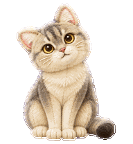

# CodexPets · 乖乖

一只爱歪头、安静陪你工作的灰金色小猫，为 ChatGPT Work Pets 制作的动画宠物资源。

## 动画预览

[MP4 视频](pets/guaiguai/previews/guaiguai-motion-preview.mp4) · [跳跃预览](pets/guaiguai/previews/guaiguai-jump.gif) · [视线循环](pets/guaiguai/previews/guaiguai-look.gif)

## 资源文件

- [透明精灵图](pets/guaiguai/spritesheet.png)
- [16 个视线方向对照图](pets/guaiguai/previews/guaiguai-look-revised.png)
- [动作静帧](pets/guaiguai/previews/guaiguai-stills.png)

精灵图采用 v2 布局，PNG RGBA 格式，尺寸为 1536 × 2288 像素。共 8 列、11 行，每个单元格为 192 × 208 像素，包含 73 个有效帧。未使用的单元格保持透明。

| 行（从 0 开始） | 动作 | 帧数 |
| --- | --- | --- |
| 0 | 待机 idle | 6 |
| 1 | 向右跑 running-right | 8 |
| 2 | 向左跑 running-left | 8 |
| 3 | 招手 waving | 4 |
| 4 | 跳跃 jumping | 5 |
| 5 | 失败反应 failed | 8 |
| 6 | 等待输入 waiting | 6 |
| 7 | 专注工作 running | 6 |
| 8 | 检查成果 review | 6 |
| 9 | 视线 000°–157.5° | 8 |
| 10 | 视线 180°–337.5° | 8 |

视线以屏幕坐标为准，从向上 000° 开始，按顺时针每 22.5° 一帧。090° 为右，180° 为下，270° 为左。

## 使用方式

通过支持自定义 Pets 的工具导入 pets/guaiguai/spritesheet.png，先验证精灵图，再上传、创建并选用宠物。资源下载后需要通过 Pets 创建流程才能在账号中使用。

本资源已于 2026-11-16 通过本地 v2 结构与质量检查，以及 Pets 插件精灵图预检，并在创建者账号中创建、选用。

## 制作说明

以用户提供的小猫参考素材为基础，使用图像生成制作动作，再通过脚本提取、组装、去除背景并验证。角色特征包括灰金色条纹、奶油色胸口、金色圆眼睛和歪头姿态。
